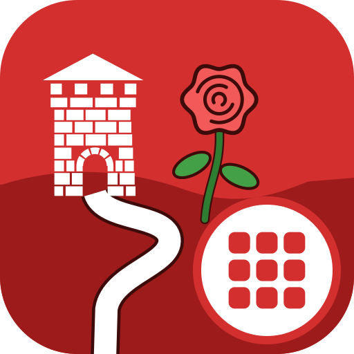

<h1 align="center">Rosenweg Launcher</h1>

Startbildschirm der Rosenweg-Smartphones – jede Person mit ihrer eigenen Startseite.

<a href="https://www.rosenweg4303.ch/apps">Herunterladen</a> · <a href="docs/anleitung.md">Anleitung</a> · <a href="docs/entwickeln.md">Für Entwickler</a>

## Was die App kann

- Startseite mit Uhr-Widget und Rosenweg Kamera.
- Auf geteilten Telefonen eigene Startseite und Einstellungen je Person.
- Aufgeräumt: kein Store-Symbol; auf verwalteten Telefonen kein Deinstallieren.
- Hält auf dem eigenen Handy alle Rosenweg-Apps aktuell (Rosenweg Updater).

## Plattformen

Android.

## Entwickeln

Android-App (Kotlin, Gradle) auf Basis von [commons-rosenweg](https://github.com/Rosenweg/commons-rosenweg).
`./gradlew assembleFossRelease` – Bau, Signatur, Logo und Veröffentlichung stehen in
[docs/entwickeln.md](docs/entwickeln.md).

## Herkunft und Lizenz

Basiert auf [Fossify Launcher](https://github.com/FossifyOrg/Launcher). Herzlichen Dank an das Fossify-Team und alle Mitwirkenden für die solide Grundlage.
GPL-3.0, siehe [LICENSE](LICENSE).
